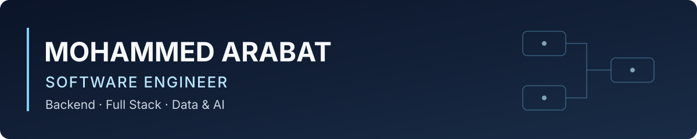

# Mohammed Arabat · Software Engineer

Ingénieur diplômé en génie logiciel et informatique à l’**ENSAO**, actuellement en **Master 2 Systèmes intelligents et Vision par ordinateur** à l’Université Sorbonne Paris Nord (2026–2027).

**Stage PFE recherché : 4 à 6 mois dès février 2027 · Mobilité France entière.**

[LinkedIn](https://www.linkedin.com/in/mohammed-arabat/) · [GitHub](https://github.com/arabat-med) · [Email](mailto:moarabat131@gmail.com)

[À propos](#à-propos) · [Pratique de l’ingénierie](#pratique-de-lingénierie) · [Compétences](#compétences-techniques) · [Expériences](#expériences-professionnelles) · [Projets](#projets-sélectionnés) · [Formation](#formation-et-certifications) · [Contact](#contact)

## À propos

Mon parcours associe le développement d’applications et l’intégration de traitements de données et de modèles IA. Chez Tessi, j’ai développé des API Java et des interfaces React ; chez COURÂGE, j’ai contribué au backend et à la génération documentaire de Qualiogen ; chez Digital Cook, j’ai travaillé sur des traitements d’images et des modules d’inférence Python.

Je recherche un stage en **ingénierie logicielle**, avec une orientation backend ou full stack. Ma formation en systèmes intelligents et vision complète ce socle pour les projets qui nécessitent du NLP ou de la Computer Vision.

## Pratique de l’ingénierie

| Domaine | Réalisations qui l’illustrent |
| --- | --- |
| **Software Engineering** | API REST sécurisées et tests JUnit chez Tessi ; backend Node.js/Prisma/PostgreSQL et génération de documents chez COURÂGE. |
| **Data & AI** | Prétraitement OpenCV, CNN/U-Net PyTorch et inférence Python chez Digital Cook ; extraction NLP dans le projet CV et traitement vidéo dans le projet V2V. |
| **Qualité et automatisation** | Tests unitaires et d’intégration, documentation technique, Docker et CI/CD selon les missions ; suites de tests et architectures consultables dans les deux projets publics. |

## Compétences techniques

| Domaine | Technologies appliquées |
| --- | --- |
| **Backend et API** | Java, Spring Security, JPA/Hibernate, Node.js, Python, Flask, API REST |
| **Frontend** | JavaScript, React ; Qt6/QML pour les interfaces de bureau |
| **Données et documents** | PostgreSQL, Prisma, JSON/JSONL, python-docx, ReportLab |
| **IA et vision** | PyTorch, CNN, U-Net, OpenCV, spaCy/NER, regex ; intégration de YOLO11n et ByteTrack |
| **Tests et outils** | JUnit, pytest, CTest, ESLint, Git, GitHub Actions, CMake, Docker/Compose, Coolify, SonarQube |

Les expériences ci-dessous précisent l’usage professionnel de ces outils ; les projets donnent accès au code, aux flux de données et aux limites techniques.

## Expériences professionnelles

### Digital Cook · Développeur Python / IA

*Avril–septembre 2026*

- **Contexte :** traitement d’images microscopiques, de la préparation des images à l’exécution de modèles.
- **Ma contribution :** prétraitement d’images avec OpenCV, implémentation et entraînement de CNN et U-Net avec PyTorch, développement de modules Python de chargement de modèles et d’inférence ; utilisation de Docker et de pipelines CI/CD.
- **Technologies :** Python, OpenCV, PyTorch, Docker, CI/CD.
- **Livrables :** modules de prétraitement, modèles entraînés, modules d’inférence Python et conteneurisation.
- **Preuve disponible :** [site officiel Digital Cook](https://www.digitalcook.fr/) pour le contexte de l’entreprise. Aucun extrait de code ni résultat de modèle de cette mission n’est présenté ici.

### COURÂGE · Développeur Full Stack

*Janvier–août 2025 · Contribution centrée sur le backend*

- **Contexte :** Qualiogen, plateforme SaaS dédiée à la conformité Qualiopi et à la gestion documentaire des organismes de formation.
- **Ma contribution :** développement backend et génération automatique de documents ; travail avec Prisma et PostgreSQL, Docker Compose, Coolify, SonarQube et CI/CD ; rédaction de documentation technique dans une équipe Agile Scrum.
- **Technologies :** Node.js, Prisma, PostgreSQL, Docker Compose, Coolify, SonarQube.
- **Livrables :** composants backend, génération documentaire et documentation technique.
- **Preuve disponible :** [produit public Qualiogen](https://qualiogen.fr/). Ce lien présente le produit actuel ; ma contribution porte sur les éléments décrits ci-dessus. Aucun extrait de code de la mission n’est présenté ici.

### Tessi · Développeur Full Stack Java / React

*Juin–septembre 2024*

- **Contexte :** contribution à une application web associant une API sécurisée et des interfaces de saisie.
- **Ma contribution :** développement d’API REST sécurisées avec Spring Security et JPA/Hibernate, d’interfaces React et de formulaires dynamiques ; écriture de tests JUnit unitaires et d’intégration.
- **Technologies :** Java, Spring Security, JPA/Hibernate, React, JUnit.
- **Livrables :** API REST, interfaces et formulaires, tests unitaires et d’intégration.
- **Preuve disponible :** [site officiel Tessi](https://www.tessi.eu/fr/) pour le contexte de l’entreprise. Aucun extrait de code ni livrable de cette mission n’est présenté ici.

Les contributions professionnelles sont décrites à partir de mon parcours. Les sites d’entreprise et de produit ne constituent pas une preuve d’attribution individuelle.

## Projets sélectionnés

### Extraction et génération automatique de CV

**Projet académique individuel · Prototype full stack documenté**

- **Contexte :** transformer un CV PDF ou Word en données structurées, puis produire des documents Word et PDF.
- **Ma contribution :** réalisation individuelle de l’application : interface React, API Flask, extraction NLP, normalisation JSON et génération de documents Word/PDF.
- **Technologies :** Python, Flask, spaCy/NER, regex, React, JSON, python-docx, ReportLab, pytest.
- **Livrables du projet :** interface d’import et de consultation, API d’extraction, normalisation JSON, génération documentaire, tests et protocole de démonstration.
- **Preuves disponibles :** [code et architecture](https://github.com/arabat-med/Projet-CV-ATS-main), [démonstrations reproductibles](https://github.com/arabat-med/Projet-CV-ATS-main/blob/master/docs/DEMONSTRATIONS.md), [validation et tests](https://github.com/arabat-med/Projet-CV-ATS-main/blob/master/docs/VALIDATION.md).

**Flux principal :** React → API Flask → lecture PDF/DOCX → NER et règles → JSON structuré → génération Word/PDF.

**Limites et suite possible :** pas d’OCR pour les PDF scannés ; extraction dépendante de la structure des documents ; précision NLP et compatibilité ATS non benchmarkées. Une évaluation sur un jeu indépendant de CV serait une prochaine étape. Les tests documentés valident des comportements logiciels, pas une précision générale d’extraction.

### Transports intelligents · Simulation V2V et extension vision

**Prototype de bureau C++/Qt6 · Traitement vidéo local**

- **Contexte :** explorer la mobilité sur un réseau routier OpenStreetMap et visualiser les liens de portée entre véhicules.
- **Ma contribution :** développement de la simulation C++/Qt6. Le dépôt présente le moteur, les modèles C++/QML et une extension Python de détection, de suivi et d’export de trajectoires vidéo.
- **Technologies :** C++17, Qt6/QML, OpenStreetMap, CMake/CTest ; Python, YOLO11n/Ultralytics, ByteTrack, OpenCV et JSONL pour l’extension.
- **Livrables :** application de simulation, visualisation des graphes de portée, traitement vidéo hors ligne, export de trajectoires et lecture dans Qt, tests et documentation.
- **Preuves disponibles :** [code et architecture](https://github.com/arabat-med/v2v-traffic-simulation), [guide vidéo → Qt](https://github.com/arabat-med/v2v-traffic-simulation/blob/main/vision/README.md), [tests C++](https://github.com/arabat-med/v2v-traffic-simulation/blob/main/tests/core_tests.cpp).

**Flux de simulation :** réseau OSM → graphe routier → véhicules simulés → graphe de portée → modèles Qt/QML.

**Flux vidéo :** vidéo → YOLO11n et ByteTrack → projection après calibration → fichier JSONL → lecture dans Qt.

**Limites et suite possible :** les liens V2V suivent un modèle géométrique, sans échange de messages ni simulation radio physique. L’extension traite une vidéo par fichier ; la précision de projection reste à valider avec une caméra réelle et des repères indépendants. FastAPI, Docker et MLflow ne font pas partie de cette implémentation. Les tests de calibration synthétiques ne démontrent pas une précision terrain.

## Formation et certifications

| Parcours | Établissement | Période |
| --- | --- | --- |
| **Master 2 Systèmes intelligents et Vision par ordinateur** | Université Sorbonne Paris Nord | 2026–2027 |
| **Master 1 Informatique et Mobilité** | Université de Haute-Alsace | 2025–2026 |
| **Diplôme d’ingénieur en génie logiciel et informatique** | ENSAO | Diplôme obtenu |

- Oracle Certified Professional — Java SE 21 Developer.
- Cisco CCNA — Switching, Routing, and Wireless Essentials.

## Contact

**Stage PFE en ingénierie logicielle · 4 à 6 mois dès février 2027 · France entière.**

- **Email :** [moarabat131@gmail.com](mailto:moarabat131@gmail.com)
- **LinkedIn :** [mohammed-arabat](https://www.linkedin.com/in/mohammed-arabat/)
- **GitHub :** [arabat-med](https://github.com/arabat-med)
